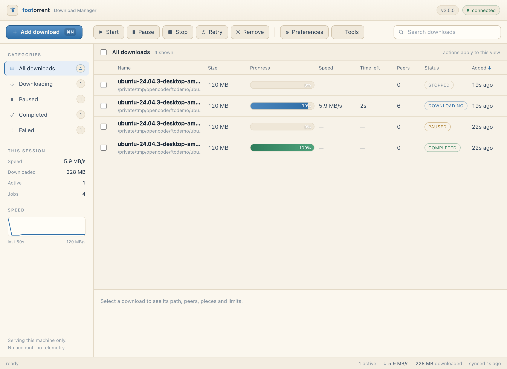
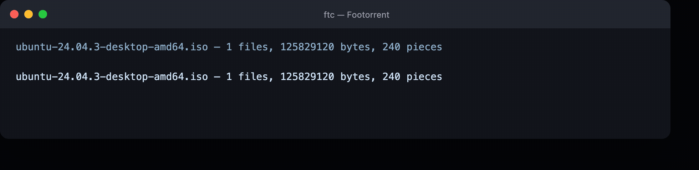
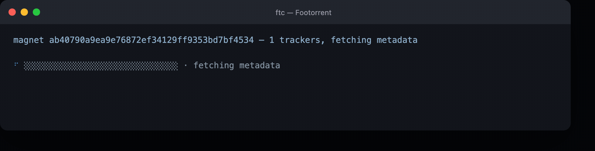
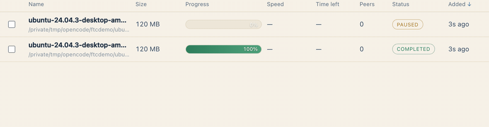
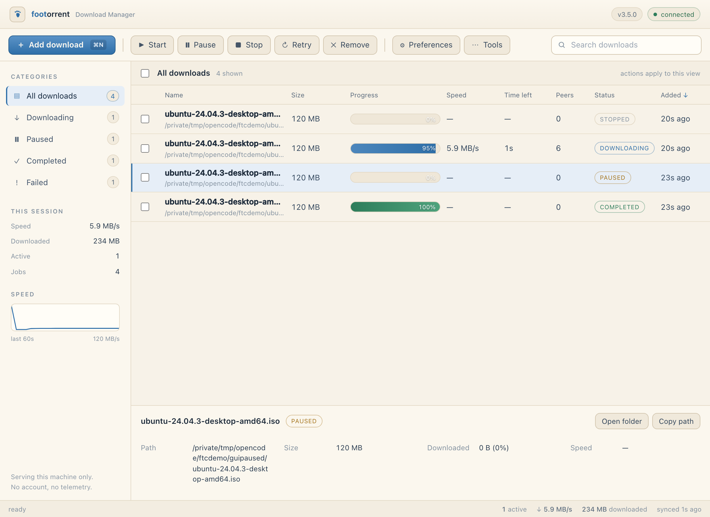
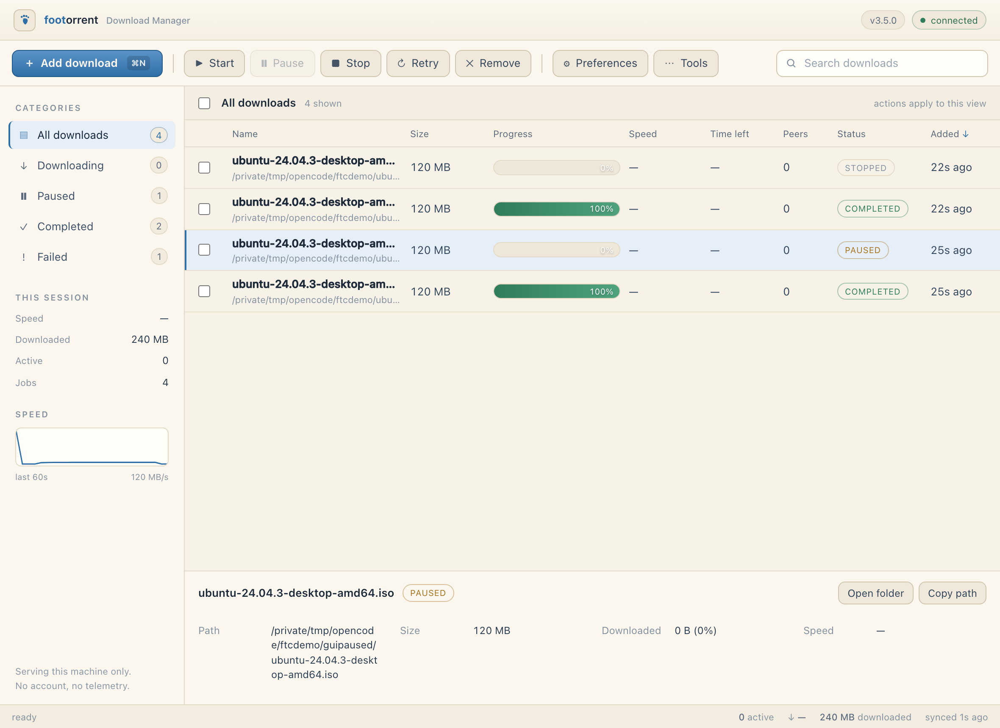

<div align="center">



# Footorrent

### Small footprint. Big downloads.

**The free, open-source BitTorrent client that fits in one ~3 MB binary.**

**Rust · from scratch · no libtorrent · no Electron · no runtime to install**
**No ads · no bundles · no telemetry · no paid tier**

[](https://github.com/cyberd4ch/footorrent/releases/latest)
[](https://github.com/cyberd4ch/footorrent/actions/workflows/test.yml)
[](LICENSE)


</div>

One engine, two faces: the window above is the same program the terminal uses.
The GUI is a download manager — categories, a live sortable table, pause and
resume, per-peer detail — and the CLI renders progress against the very same
counters, so the two can never disagree.

---

## Why Footorrent

The big torrent clients became the reason you need an alternative. µTorrent and
BitTorrent grew into ad platforms — banner slots, bundled offers, upsells in the
installer. qBittorrent and Deluge cleaned up the ethics but ship tens of
megabytes of runtime for what is, underneath, one protocol. And closed-source
clients ask you to trust a black box with your network activity.

---

## What it looks like

Everything below was captured from the running program — one seedbox process
serving a genuine 120 MB Ubuntu image torrent over loopback, this client
downloading it. Nothing is mocked, no number is edited.

### A download, at your prompt

The bar fills with the same gradient the GUI uses, counts real peers, and
finishes with a quiet checkmark.



The capture above honors a `--limit 6M` cap, so the clock is honest: **5.9 MB/s
steady, 120 MB in about 20 seconds**. Uncapped against a fast seed, the same
transfer completes in **0.7 seconds**. Six peer slots; the bar shows what the
engine sees, live.

### A magnet, looked up before it lands

Paste a bare magnet with no `.torrent` file: Footorrent contacts the swarm,
fetches the metadata from a peer, verifies it against the info hash, and only
then asks where you want it.



### The download manager

`ftc gui` opens a local window that behaves like the download manager it is —
no account, no telemetry, bound to loopback unless you ask otherwise.



Pause amber. Stopped hushes. Finished turns green — with the piece count, peer
rates and path in the details pane:

| Paused | Finished |
| :---: | :---: |
|  |  |

---

## Install

```bash
curl -fsSL https://raw.githubusercontent.com/cyberd4ch/footorrent/main/install.sh | sh
```

Detects macOS or Linux and the CPU, downloads the matching archive, checks it
against `SHA256SUMS`, and puts `ftc` on your PATH — `/usr/local/bin` when that is
writable, `~/.local/bin` otherwise. It also installs **`footorrent`** beside it
as an alias for the same binary; on Windows the installer writes
`footorrent.cmd`. No toolchain, no runtime, no sudo unless you ask for it.

On macOS it also installs **a real app**: `~/Applications/Footorrent.app`, a
native window around the same engine that starts the server itself and quits it
when you close the window. On Windows the installer adds a Start Menu entry and
on Linux a `ftc.desktop` file, both running `ftc gui`. One installed binary,
both interfaces: the command line when you want it, a window when you don't.

### What the installer does, in the open

You shouldn't have to trust a script you pipe to `sh`. The installer is a
single readable file, and it reports every step as it runs: which archive it
fetched, from where, the digest check's verdict, where the binary went and what
it put beside it. Each step is a small, ordinary shell command — there are no
hidden posts, no environment writes, no leftovers in your dotfiles. The
shell launcher is checked with **shellcheck** and the PowerShell one with
**PSScriptAnalyzer** in CI on every change, and the badge above only lights up
when tests *and* script gates pass.

```powershell
# Windows, in PowerShell
irm https://raw.githubusercontent.com/cyberd4ch/footorrent/main/install.ps1 | iex
```

### Or grab an archive

Archives, not bare binaries — and that is deliberate. An executable downloaded as
a plain file loses its permission bits, so macOS and Linux hand you something that
double-clicks into a text editor showing megabytes of binary.

| Platform | Archive | Size |
| :--- | :--- | ---: |
| **macOS** app (Apple silicon) | [`ftc-macos-app.zip`](https://github.com/cyberd4ch/footorrent/releases/latest/download/ftc-macos-app.zip) | 1.4 MB |
| **macOS** Apple silicon | [`ftc-macos-arm64.tar.gz`](https://github.com/cyberd4ch/footorrent/releases/latest/download/ftc-macos-arm64.tar.gz) | 1.4 MB |
| **macOS** Intel | [`ftc-macos-x86_64.tar.gz`](https://github.com/cyberd4ch/footorrent/releases/latest/download/ftc-macos-x86_64.tar.gz) | 1.5 MB |
| **Linux** x86_64 | [`ftc-linux-x86_64.tar.gz`](https://github.com/cyberd4ch/footorrent/releases/latest/download/ftc-linux-x86_64.tar.gz) | 1.5 MB |
| **Windows** x86_64 | [`ftc-windows-x86_64.zip`](https://github.com/cyberd4ch/footorrent/releases/latest/download/ftc-windows-x86_64.zip) | 1.3 MB |

```bash
tar xzf ftc-macos-arm64.tar.gz      # ftc arrives as mode 0755
./ftc --version
```

```powershell
Expand-Archive ftc-windows-x86_64.zip -DestinationPath .
.\ftc.exe --version
```

Every release also ships [`SHA256SUMS`](https://github.com/cyberd4ch/footorrent/releases/latest/download/SHA256SUMS).
Verify before you run it:

```bash
curl -LO https://github.com/cyberd4ch/footorrent/releases/latest/download/SHA256SUMS
shasum -a 256 -c SHA256SUMS --ignore-missing      # linux: sha256sum -c
```

## Use

```bash
ftc ./some.torrent -o ./downloads
ftc "magnet:?xt=urn:btih:..." -o ./downloads
ftc ./some.torrent -o ./downloads --seed 300     # keep serving after it finishes
```

```
USAGE:
    ftc <file.torrent | magnet:?xt=urn:btih:...> [options]

OPTIONS:
    -o, --output <dir>    where files are written (default: current directory)
        --peers <list>    comma-separated host:port peers, skipping the tracker
        --max-peers <n>   simultaneous peer connections (default: 6)
        --no-dht          skip DHT peer discovery (trackers only)
        --port <n>        port to announce over trackers and the DHT (default: 6881)
        --seed <secs>     after finishing, serve pieces to peers for <secs>s
        --limit <rate>    cap the download rate, e.g. 500k or 2M (default: unlimited)
```

Progress renders in place, no log spam — and the number on it is the engine's
own aggregated rate, the same number the GUI table shows:

```
⠴ [██████████████░░░░░░░░░░░░░░░░] · 5.9 MB/s · eta 13s · 6 peers
```

A magnet with no tracker still works: it hunts peers through the DHT, fetches
the `info` dictionary from them (BEP 9/10), and verifies it against the info
hash before writing a single byte. Peers you already know can be forced with
`--peers host:port,host:port`, and crowded local networks can be steered away
from port collisions with `--port`.

Adding a magnet from the web UI is deliberate on purpose: step one contacts the
swarm and confirms what it actually is — real name, exact byte size, piece
count and file list — step two asks where it should go, and only then does
anything touch disk.

### Is the swarm dead, or is the client stuck?

```bash
ftc swarm "magnet:?xt=urn:btih:..."
```

Announces to every tracker in the link — falling back to public trackers when
that list is dead — asks the DHT, dedupes the peers and TCP-probes them, then
reports how many trackers answered and how many peers actually accept a
connection. A magnet with 20 known peers and 2 reachable is a dead swarm, not a
broken download.

## The download manager

```bash
ftc gui                          # web ui, opened in your browser
ftc serve                        # http://127.0.0.1:8080, terminal only
ftc serve --port 9000 -o ~/Downloads
ftc serve --limit 2M             # default cap for every job added from the page
```

The same engine behind a local download manager — the window at the top of this
page. Categories with live counts, a sortable table (size, progress, speed,
time left, peers, status, age), multi-select with Start/Pause/Stop/Retry/Remove,
an add sheet that confirms a magnet before it can write anything, failed jobs
carrying a Retry button and a **Copy infohash** action, and per-peer rates in
the details pane. Drop a `.torrent` file anywhere on the page or a magnet link,
and it queues; Tools clears finished jobs, exports the list as JSON and copies
every path; the sidebar keeps a 60-second speed graph; Preferences can send a
desktop notification when a download finishes or fails, and can set the default
folder and cap. No extra dependency, no second process — the page ships inside
the binary — and it binds loopback only unless you ask for `--bind`.

The engine keeps one negotiated connection across many pieces instead of
re-dialing per piece: on a lone seed you get sustained throughput rather than a
stuttering 30 KB/s crawl, and a half-second local metadata exchange on the
lookups above.

The speed limit in the add sheet caps that one job, and Preferences (or
`--limit` at startup) sets the default for the ones added afterwards. The cap
is a single shared token bucket in the engine, so `2M` means two mebibytes per
second across all peers — not per connection — and a rate it cannot parse is
rejected rather than silently ignored. Pause parks the workers without touching
verified progress; resume continues from the same queue. Pause and Stop land
between 16 KiB blocks, not at the end of a piece, so the UI reads the truth in
real time.

## What you get for 3 MB

| | |
| :--- | :--- |
| **No runtime.** Static binary. No Node, no Python, no JVM, no Electron download on first launch. | **No libtorrent.** Bencode, trackers, wire protocol, DHT and seeding are this repo's code. |
| **No ads, no bundles, no telemetry.** The protocol stack talks to trackers, DHT peers and nothing else. | **Honest seeding.** The bitfield is built from verified pieces only — it never claims a piece it can't prove. |
| **Resumable.** Existing pieces are re-verified on disk, so a restart continues instead of redownloading. | **Multi-file torrents.** Crosses file boundaries without stitching buffers. |
| **A real speed cap.** `--limit 2M` is one shared token bucket, so the number is the aggregate across peers — not a per-connection trickle. | **Pause and resume.** Workers park between blocks; verified pieces are never downloaded twice. |
| **Safe paths.** `..`, absolute paths and separators are rejected before any file is opened. | **Capped frames.** Peer messages cannot exhaust memory — sound from the first packet. |

## Protocol coverage

| Area | |
| :--- | :--- |
| Bencode codec, exact `info` byte-span for hashing | ✅ |
| `.torrent` parsing — single and multi-file | ✅ |
| Magnet URIs — hex and base32 info hashes | ✅ |
| Metadata exchange (BEP 9/10) — magnet-only downloads, and the seeder serves it too | ✅ |
| HTTP tracker announces — compact and dictionary peers | ✅ |
| UDP tracker announces (BEP 15) | ✅ |
| Peer wire protocol — handshake, bitfield, choke, request/piece | ✅ |
| SHA-1 piece verification, corrupt pieces re-queued | ✅ |
| Resume from disk, multi-file storage mapping | ✅ |
| Tracker re-announce and peer refill | ✅ |
| DHT (BEP 5) — `get_peers` hunting and announce | ✅ |
| Seeding (`--seed`) | ✅ |
| Web UI + local JSON API (`ftc serve`) | ✅ |
| Two-step magnet adds (resolve + confirm + start) | ✅ |
| Pause / resume / stop / retry from the page, engine-side | ✅ |
| Swarm diagnostics (`ftc swarm`) — trackers, DHT, TCP reachability | ✅ |
| Download rate limit (`--limit`, per-job `limit`) | ✅ |
| Live download bar mirroring the GUI's own states | ✅ |

## Design notes

- **The info hash is computed over the original `info` bytes**, not a re-encoded
  dictionary, so unusual key ordering can't change a torrent's identity.
- **Peer frames are capped at 2 MiB** before allocation; a hostile length header
  can't exhaust memory.
- **A bad piece goes back on the queue**, the peer that sent it is disconnected,
  and the run fails only after several refill attempts — slow peers never strand
  a round on their own.
- **The seeder lies about nothing**: a request outside the verified set
  disconnects the peer rather than guessing.

## Build from source

Rust stable (the included `rust-toolchain.toml` pins the stable toolchain with
`clippy` and `rustfmt`; edition 2021):

```bash
git clone https://github.com/cyberd4ch/footorrent
cd footorrent
cargo build --release        # target/release/ftc
```

## Test

```bash
cargo test --all
cargo clippy --all-targets -- -D warnings
cargo fmt --all -- --check
```

64 tests — 42 in the engine, 22 in the CLI. The suite is end-to-end where it
matters: a fake peer serves a real torrent and the session downloads, verifies
and writes it; a fake router → holder chain over UDP exercises a full DHT hunt
and a token-validated announce; a fake leecher pulls one block from the seeder
and is dropped for asking beyond the torrent; and a magnet-style fetcher
receives the exact info-dictionary bytes from the seeder's metadata exchange.

## Contributing

Issues and pull requests are welcome. A few ground rules that keep the project
small and yours to trust:

- `cargo test --all && cargo clippy --all-targets -- -D warnings && cargo fmt --all -- --check`
  must pass — CI runs the same gate.
- New transports or features should fail soft: a dead tracker or a hostile peer
  is data, not a crash.
- No new runtime dependencies unless the protocol truly needs them; the current
  handful is a design decision, not an accident.
- Contributed code arrives under GPL-3.0-or-later — that is how the client
  stays free for the next person too.

## Roadmap

1. A native Windows front end on the same local JSON API (the macOS app already
   runs on it).

## License

Footorrent is free software under the
**[GNU GPL v3.0-or-later](LICENSE)** — copyright © 2025–2026 cyberdach.
